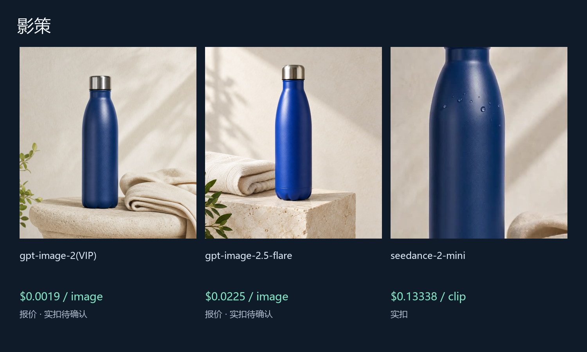
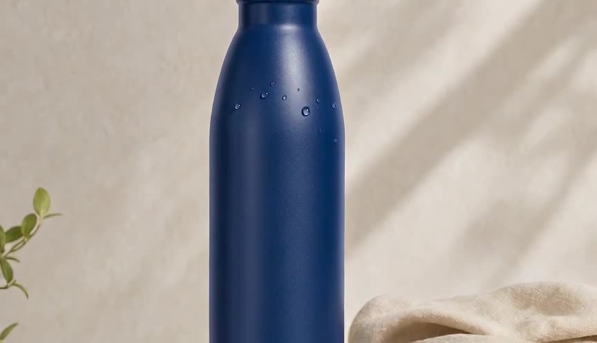

# 更低成本的 影策 图片与视频方案

[English](README.md) | 中文

在画布上组织图片、视频和创作任务.

完成独立 API 图片生成、首帧上传和视频生成；提供声明式图片插件候选包。尚未运行原生 Go 校验器、插件导入及画布端验收；候选插件尚无宿主内报价门控，视频首帧上传仍需专门映射。

Upstream: [ddcat-ai/open-ai-canvas](https://github.com/ddcat-ai/open-ai-canvas) · fixed SHA `2934d9c11ad2aaeb38a7a7f712feb0ebc5e4160f` · MIT. Community work by ToAPIs; no upstream endorsement or partnership is implied. Existing sponsors and referral links are unchanged. “Lower-cost” describes the priced ToAPIs route, not a measured savings claim against every upstream supplier.

## 演示



### gpt-image-2(VIP) — $0.0019 报价，实扣待确认


```json
{
  "model": "gpt-image-2-vip",
  "n": 1,
  "size": "1:1",
  "resolution": "1K",
  "quality": "low"
}
```

### gpt-image-2.5-flare — $0.0225 报价，实扣待确认


```json
{
  "model": "gpt-image-2.5-flare",
  "n": 1,
  "size": "1:1",
  "metadata": {
    "resolution": "1K"
  },
  "quality": "high"
}
```

### seedance-2-mini — $0.13338 实扣

[](assets/seedance-2-mini-1730f81284.mp4)

[MP4 — 4.04s](assets/seedance-2-mini-1730f81284.mp4)

```json
{
  "model": "seedance-2-mini",
  "duration": 4,
  "resolution": "480p",
  "aspect_ratio": "16:9",
  "generate_audio": false
}
```

## API pricing

| Model / 模型 | Preset / 参数 | API pricing | Case / 本次案例 |
|---|---|---|---|
| gpt-image-2(VIP) | n=1, size=1:1, resolution=1K, quality=low | $0.0019/image | $0.0019 quote |
| gpt-image-2.5-flare | n=1, size=1:1, metadata={'resolution': '1K'}, quality=high | $0.0225/image | $0.0225 quote |
| seedance-2-mini | duration=4, resolution=480p, aspect_ratio=16:9, generate_audio=False | $3.285714/M tokens | $0.13338 actual; 4.04s; $0.033015/s observed |

Token-metered rates use actual tokens; the observed $/s is this case’s settled cost divided by decoded MP4 duration, not a fixed future rate. Quotes are same-Key prices dated 2026-10-22, not confirmed charges. The client rechecks pricing before a paid submission.

## Run / 运行

No dependencies for the standalone client. Set `TOAPIS_API_KEY` privately. Base URL is `https://toapis.com` (without `/v1`); the client adds `/v1`.

```sh
python unified_client.py --model gpt-image-2-vip --prompt-file prompts/image.txt --max-usd .10
# quote only; explicitly add --live to submit a paid job
python unified_client.py --model gpt-image-2-vip --prompt-file prompts/image.txt --max-usd .10 --live --run-id my-reviewed-case
```

Video first-frame preset: add `--image outputs/your-first-frame.png`; upload becomes `image_with_roles=[{url,role:"first_frame"}]`.

Same request + same run ID resumes the existing task. If a POST response is uncertain and has no ID, stop and reconcile; do not issue a replacement POST. Polling: `GET /v1/images/generations/{id}` or `/v1/videos/generations/{id}`; result: `result.data[0].url`; Bearer auth applies only to the API, not result downloads. Read settled `billing.cost_usd` and `billing.credits`; missing final billing stays unknown. Public case records exclude task IDs, credentials and account data.

[Integration details / 接入边界](integration/README.md) · [Original image prompt](prompts/image.txt) · [Video prompt](prompts/video.txt) · [Sanitized cases](cases.json)

[Model pricing & signup / 模型价表及注册](https://go2v.toapis.com/1022_yc) · Campaign: `1022_yc`
